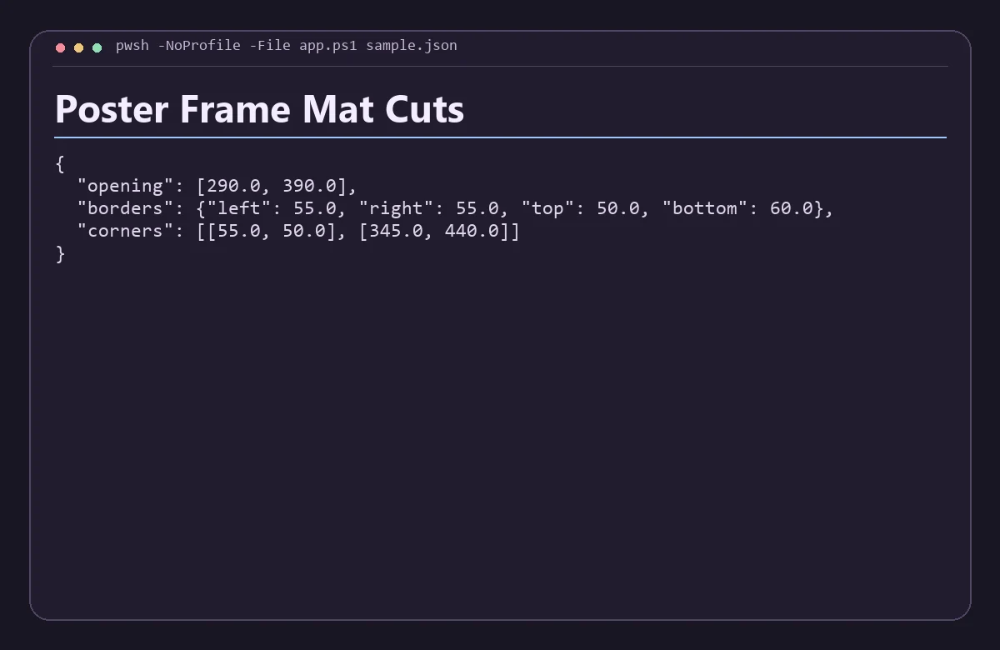

# Poster Frame Mat Cuts

Calculate a mat opening, four border widths and opening corners for a print with a bottom-weighted mount.



## Run

Install PowerShell 7 or newer. Run these commands from the repository root.

```sh
pwsh -NoProfile -File app.ps1 sample.json
```

Replace `sample.json` with a JSON file following the same structure. The app prints a JSON report to standard output.

Use millimetres throughout. Frame is the interior width and height. Overlap covers each print edge. extra_bottom is the difference between the bottom and top borders. Coordinates are measured from the upper-left corner of the mat.

## Verify

Run `python check.py` with Python 3.11 or newer after the build step when applicable. The check verifies the bundled scenario and confirms that an invalid input returns an error.
